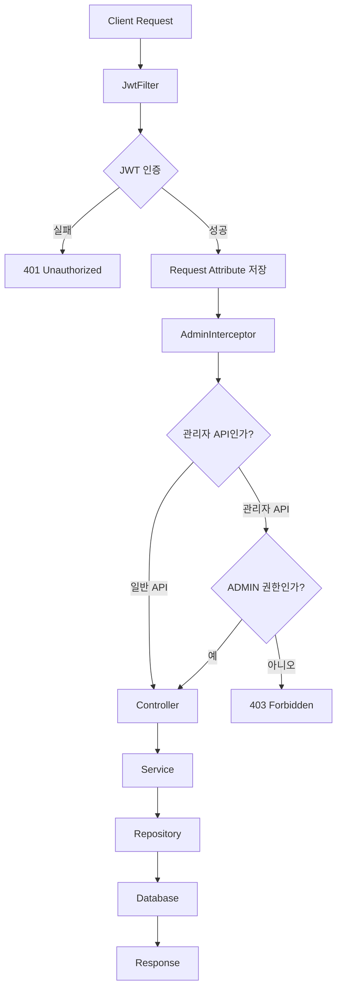
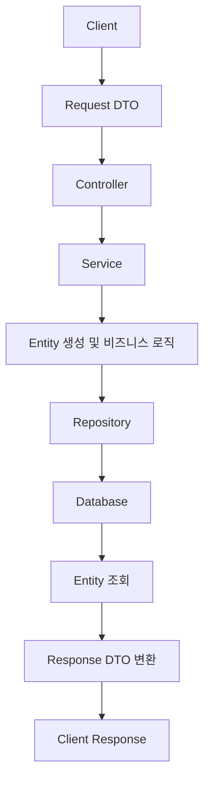
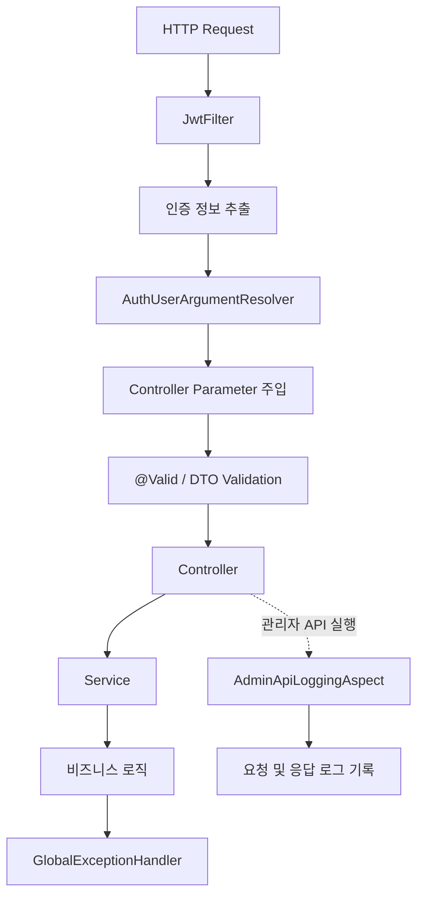
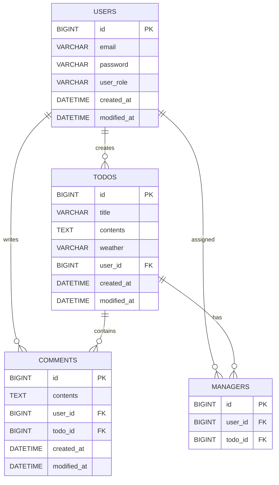

# SPRING ADVANCED

Spring Boot 기반의 일정 관리 API 프로젝트입니다.  
회원 인증 및 권한 관리, 일정·댓글·담당자 관리 기능을 구현하고, JPA를 활용한 데이터 조회 최적화와 예외 처리, AOP 기반 관리자 API 로깅 등을 적용했습니다.

---

## 목차

1. [프로젝트 소개](#1-프로젝트-소개)
2. [기술 스택](#2-기술-스택)
3. [주요 기능](#3-주요-기능)
4. [프로젝트 구조](#4-프로젝트-구조)
5. [시스템 처리 흐름](#5-시스템-처리-흐름)
6. [ERD](#6-erd)
7. [API 명세](#7-api-명세)
8. [주요 구현 내용](#8-주요-구현-내용)
9. [테스트 및 커버리지](#9-테스트-및-커버리지)
10. [트러블슈팅](#10-트러블슈팅)
11. [실행 방법](#11-실행-방법)

---

## 1. 프로젝트 소개

### 프로젝트 목적

Spring Boot와 Spring Data JPA를 활용하여 일정 관리 서비스를 구현하고, 애플리케이션의 인증·인가 및 데이터 처리 구조를 개선하는 것을 목표로 합니다.

### 주요 도메인

- **User**: 회원가입, 로그인, 비밀번호 변경 및 권한 관리
- **Todo**: 일정 등록 및 조회
- **Comment**: 일정 댓글 등록 및 조회
- **Manager**: 일정 담당자 등록 및 조회·삭제
- **Admin**: 관리자 권한 검증 및 관리자 API 관리

## 2. 기술 스택

| 구분 | 기술 |
|---|---|
| Language | Java 17 |
| Framework | Spring Boot 3.3.3 |
| ORM | Spring Data JPA, Hibernate |
| Database | MySQL |
| Build Tool | Gradle |
| Authentication | JWT |
| Password Encryption | BCrypt |
| Validation | Jakarta Bean Validation |
| AOP | Spring AOP |
| Test | JUnit 5, Mockito |
| API Test | Postman |
| IDE | IntelliJ IDEA |

## 3. 주요 기능

### 회원 및 인증
- 회원가입 및 로그인
- BCrypt를 이용한 비밀번호 암호화
- JWT 기반 인증
- 사용자 권한 구분 (`USER`, `ADMIN`)
- 비밀번호 변경 및 입력값 검증

### 일정 관리
- 일정 등록 및 조회
- 페이지네이션 적용
- 페이지 번호와 페이지 크기 검증
- 날씨 API를 이용한 일정 날씨 정보 저장

### 댓글 관리
- 일정별 댓글 등록 및 조회
- 관리자 댓글 삭제

### 담당자 관리
- 일정 담당자 등록 및 조회
- 일정 작성자 권한 검증
- 담당자 삭제

### 관리자 기능
- 관리자 API 접근 권한 검증
- 관리자 권한 변경
- 관리자 API 실행 로그 기록

## 4. 프로젝트 구조

```text
src
├── main
│   ├── java/org/example/expert
│   │   ├── client
│   │   │   ├── dto
│   │   │   └── WeatherClient.java
│   │   ├── config
│   │   │   ├── AdminApiLoggingAspect.java
│   │   │   ├── AdminInterceptor.java
│   │   │   ├── AuthUserArgumentResolver.java
│   │   │   ├── FilterConfig.java
│   │   │   ├── GlobalExceptionHandler.java
│   │   │   ├── JwtFilter.java
│   │   │   ├── JwtUtil.java
│   │   │   ├── PasswordEncoder.java
│   │   │   ├── PersistenceConfig.java
│   │   │   └── WebConfig.java
│   │   ├── domain
│   │   │   ├── auth
│   │   │   ├── comment
│   │   │   ├── common
│   │   │   ├── manager
│   │   │   ├── todo
│   │   │   └── user
│   │   └── ExpertApplication.java
│   └── resources
│       └── application.yml
└── test
    └── java/org/example/expert
        ├── config
        ├── domain
        └── ExpertApplicationTests.java
```

## 5. 시스템 처리 흐름

### 5-1. HTTP 요청 및 인증 처리 흐름

클라이언트의 요청이 서버에 도착한 후 JWT 인증과 관리자 권한 검증을 거쳐 Controller에 전달되는 과정입니다.



### 5-2. 데이터 처리 흐름

Controller에서 전달받은 요청 DTO를 Service에서 처리하고 Repository를 통해 데이터베이스에 저장하거나 조회하는 과정입니다.



### 5-3. 공통 기능 처리 흐름

인증, 요청 파라미터 처리, 유효성 검증, 예외 처리 및 AOP 로깅의 역할을 구분했습니다.



## 6. ERD

현재 Entity의 연관관계를 기준으로 작성한 데이터 모델입니다.



## 7. API 명세

기본 주소: `http://localhost:8080`

| Method | Endpoint | 기능 | 인증 |
|---|---|---|---|
| POST | `/auth/signup` | 회원가입 | 불필요 |
| POST | `/auth/signin` | 로그인 | 불필요 |
| POST | `/todos` | 일정 등록 | 필요 |
| GET | `/todos` | 일정 목록 조회 | JWT 필터 적용 |
| GET | `/todos/{todoId}` | 일정 단건 조회 | JWT 필터 적용 |
| POST | `/todos/{todoId}/comments` | 댓글 등록 | 필요 |
| GET | `/todos/{todoId}/comments` | 댓글 조회 | JWT 필터 적용 |
| POST | `/todos/{todoId}/managers` | 담당자 등록 | 필요 |
| GET | `/todos/{todoId}/managers` | 담당자 조회 | JWT 필터 적용 |
| DELETE | `/todos/{todoId}/managers/{managerId}` | 담당자 삭제 | 필요 |
| GET | `/users/{userId}` | 사용자 조회 | JWT 필터 적용 |
| PUT | `/users` | 비밀번호 변경 | 필요 |
| DELETE | `/admin/comments/{commentId}` | 댓글 삭제 | ADMIN |
| PATCH | `/admin/users/{userId}` | 사용자 권한 변경 | ADMIN |

※ JWT 필터는 `/auth` 경로를 제외한 요청에 적용됩니다. 관리자 경로는 추가로 `AdminInterceptor`에서 ADMIN 권한을 확인합니다.

## 8. 주요 구현 내용

### 8-1. JWT 인증 및 ArgumentResolver
- `JwtFilter`에서 JWT를 검증하고 사용자 정보를 Request Attribute에 저장
- `AuthUserArgumentResolver`에서 `@Auth AuthUser` 파라미터 처리
- `WebConfig`에서 ArgumentResolver 등록

### 8-2. 입력값 검증 및 Early Return
- DTO에 Jakarta Validation 적용
- 비밀번호 길이 및 숫자·대문자 포함 여부 검증
- 중복 이메일 확인을 비밀번호 암호화보다 먼저 수행
- 불필요한 `if-else` 구조 제거

### 8-3. JPA 조회 최적화
- 기존 Fetch Join 조회 메서드를 `@EntityGraph` 방식으로 변경
- 일정 목록 및 단건 조회에서 연관된 User 정보 조회

### 8-4. 예외 처리 및 테스트 개선
- 테스트에서 실제 서비스 로직과 예외 타입 및 메시지 일치 여부 확인
- Todo 또는 연관 User가 없는 상황에 대한 예외 처리 보완
- BCrypt 비밀번호 검증 테스트 수정

### 8-5. 관리자 권한 검증
- `AdminInterceptor`에서 관리자 API 접근 권한 확인
- 인증되지 않은 요청은 401 반환
- ADMIN 권한이 없는 요청은 403 반환
- 관리자 권한이 있는 요청은 Controller로 전달

### 8-6. AOP 기반 관리자 API 로깅
- `AdminApiLoggingAspect`에서 관리자 API 실행 과정 감싸기
- 요청 사용자 ID, 요청 시간, URL, 전달 인자 기록
- 정상 응답 및 예외 발생 시 로그 구분

### 8-7. 페이지네이션 입력값 검증
- 페이지 번호가 1 미만인 경우 예외 발생
- 페이지 크기가 1 미만인 경우 예외 발생
- Spring Data JPA `Pageable`을 이용한 페이지 조회

## 9. 테스트 및 커버리지

### 테스트 실행 결과

- 총 8개 테스트 통과
- `ExpertApplicationTests`
- `PasswordEncoderTest`
- `CommentServiceTest`
- `ManagerServiceTest`

### 테스트 커버리지

| 측정 항목 | 커버리지 |
|---|---:|
| Class | 44% |
| Method | 32% |
| Line | 26% |
| Branch | 10% |

> IntelliJ IDEA Coverage 실행 결과를 기준으로 작성했습니다.

<!-- 아래 위치에 IntelliJ Coverage 결과 이미지 첨부 -->
<!-- 예:  -->

## 10. 트러블슈팅

| 문제 | 원인 및 해결 |
|---|---|
| JWT 설정 누락으로 애플리케이션 실행 실패 | `application.yml`에 JWT 설정 추가 |
| 데이터베이스 연결 실패 | JDBC URL에 데이터베이스명 추가 |
| AuthUser의 사용자 정보가 null | `WebConfig`에 ArgumentResolver 등록 |
| 일정 저장 시 연관 User 문제 | JPA 연관관계 및 엔티티 상태 확인 |
| 중복 회원가입 처리 순서 | 이메일 중복 확인을 먼저 수행하도록 변경 |
| 비밀번호 검증 로직 위치 | Service에서 DTO Validation으로 이동 |
| 연관 User 조회 방식 개선 | Fetch Join에서 EntityGraph로 변경 |
| 테스트 예외 검증 실패 | 실제 서비스 예외 타입 및 메시지에 맞게 테스트 수정 |
| 관리자 API 권한 검증 | Interceptor에서 USER와 ADMIN 권한 구분 |
| 관리자 API 로그 기록 | AOP를 적용해 요청·응답 및 예외 로그 기록 |

## 11. 실행 방법

### 요구 환경
- JDK 17
- MySQL
- IntelliJ IDEA 또는 Gradle 실행 환경

### 데이터베이스 생성

```sql
CREATE DATABASE expert;
```

### 환경 설정

`src/main/resources/application.yml`에서 데이터베이스 연결 정보와 JWT 비밀키를 로컬 환경에 맞게 설정합니다.

실제 운영 환경에서는 DB 비밀번호와 JWT 비밀키를 코드에 직접 작성하거나 Git에 커밋하지 않고 환경변수 또는 별도의 비밀정보 관리 수단을 사용해야 합니다.

### 애플리케이션 실행

```bash
./gradlew bootRun
```

Windows 환경에서는 다음 명령어를 사용할 수 있습니다.

```bash
gradlew.bat bootRun
```

### 테스트 실행

```bash
./gradlew test
```

---


